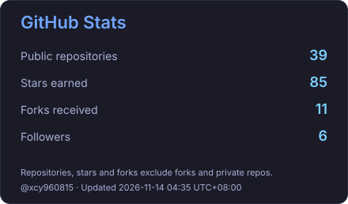
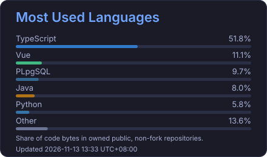
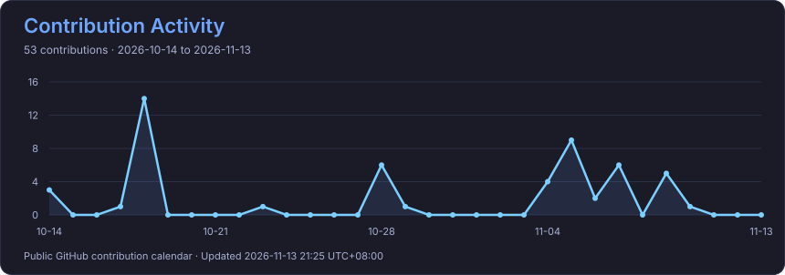

<!-- 一直敬仰左上方45度的松鼠 -->
<!--  -->

  

  <h1>Hi , I'm xcy960815</h1>
  <h3>🚀 Full Stack Developer in Progress</h3>

  

  
  

## 🌟 About Me

- 🔭 I build reusable Vue 3 components and SQL tools, including editor integration, table interactions, and SQL formatting.
- 🤝 My contributions to AntV/G2 and AntV/GUI include SSR compatibility and TypeScript export fixes.
- 🌱 Working toward full-stack development, with a focus on tools that solve practical development problems.

## 🚀 Featured Projects

| Project | What it does | Explore |
| --- | --- | --- |
| [vue3-monaco-editor](https://github.com/xcy960815/monaco-editor-vue3) | A Vue 3 wrapper for Monaco Editor with SQL keyword, database, table, field, and alias completion; supports `v-model` and TypeScript declarations. | [Docs](https://xcy960815.github.io/monaco-editor-vue3/) · [Demo](https://xcy960815.github.io/monaco-editor-vue3/guide/demo) |
| [vue3-el-table-sticky-plugin](https://github.com/xcy960815/vue3-el-table-sticky-plugin) | A Vue 3 directive that keeps Element Plus table headers visible while scrolling, with custom scroll containers, multiple tables, and dynamic layout updates. | [Docs](https://xcy960815.github.io/vue3-el-table-sticky-plugin/) · [Demo](https://xcy960815.github.io/vue3-el-table-sticky-plugin/guide/demo) |
| [sql-format-plus](https://github.com/xcy960815/sql-format-plus) | A JavaScript / TypeScript SQL formatter with configurable indentation, placeholder replacement, and support for SQL, N1QL, DB2, and PL/SQL. | [Docs](https://xcy960815.github.io/sql-format-plus/) · [Demo](https://xcy960815.github.io/sql-format-plus/guide/demo) |

### 🛠️ In Development

[PPZ Plus](https://github.com/xcy960815/ppz-plus) is a VS Code database extension for MySQL, PostgreSQL, and SQLite3. It brings database browsing, table data views, SQL execution, and export workflows into the editor, with import workflows currently focused on MySQL. The project is in early development; see its [documentation](https://xcy960815.github.io/ppz-plus/en/) for the current scope and limitations.

## 🤝 Open Source Contributions

Selected merged pull requests:

| Repository | Contribution | Pull request |
| --- | --- | --- |
| AntV/G2 | Fixed an ES module `require` error in SSR builds. | [#5450](https://github.com/antvis/G2/pull/5450) |
| AntV/GUI | Fixed an ES module `require` error in SSR builds. | [#308](https://github.com/antvis/GUI/pull/308) |
| AntV/G2 | Updated exported option types to use `ChartOptions` instead of `RuntimeOptions`. | [#5475](https://github.com/antvis/G2/pull/5475) |

## 💻 Tech Stack

### 🔧 Languages

  
  
  
  
  

### 🖥️ Frontend

  
  
  
  
  

### ⚙️ Backend

  
  
  
  

### 🧰 Tools & Utilities

  
  
  
  

## 📊 GitHub Stats

  
  

## 📈 Activity Graph

  

